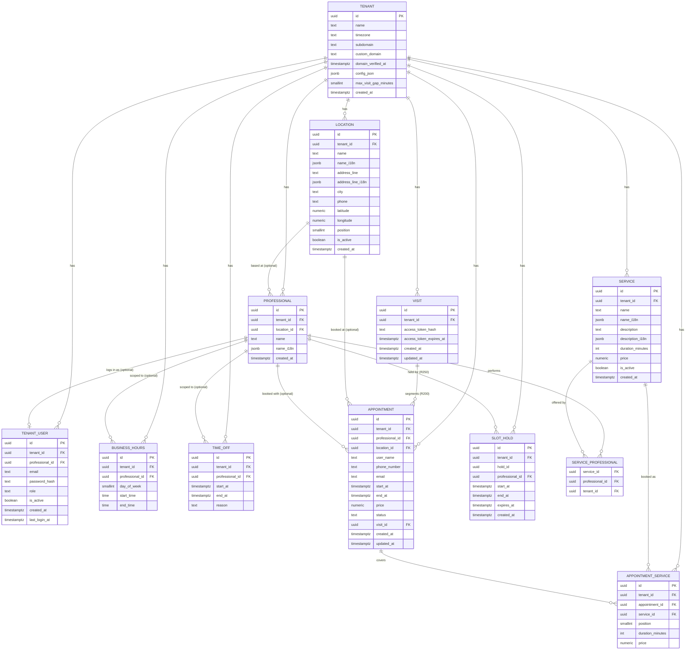

This document is a source of truth for both client and tenant side apps. System design and infrastructure should be built based on this document.

## Functional Requirements

### Client side (customer-facing booking site)

- **User** can see information about **Tenant**
- **User** can choose one or more services — at most five per booking (R210)
- **User** can have different professionals perform different services in one booking: the booking becomes a *visit* of back-to-back segments, each with its own professional (R200)
- **User** can see open appointment time slots, filtered by chosen service(s) and duration
- **User** can choose a specific **Professional** to book with, or "any available"
- **User** can choose which **Location** to book at, when the tenant has more than one (R150)
- **User** can view, reschedule, or cancel an existing booking via a magic link (see below) — no account/login required. The link covers the whole visit; rescheduling or cancelling moves or cancels every segment together (R230)
- **User** can read the site in any of the tenant's enabled locales, chosen with a switcher (R160)
- **Tenant** can edit colors and logo for the client side page (via `config_json`)
- **Tenant** can set a public-site title and description, per enabled locale (R170)

**Scope of the public site.** It exists to take a booking. Its whole content inventory is: the
tenant's title/description and logo, the service list, the location list, the booking flow, and
the magic-link management pages. Gallery, about-us, team biographies, testimonials and blog are
deliberately *not* part of it — a tenant wanting those has a marketing site elsewhere and links
to this one. This is a product decision, not a deferral.

### Tenant side (CMS)

- **Tenant** can edit service list and service details (name, price, duration, assigned professionals)
- **Tenant** can edit list of professionals
- **Tenant** can edit business hours
- **Tenant** can set the longest gap allowed between two segments of one visit, 0–60 minutes, 0 = strictly back to back (R220)
- **Tenant** can block off time (vacation, breaks, holidays) per professional or business-wide
- **Tenant** can book, reschedule, or cancel appointments on a customer's behalf
- **Tenant** can monitor booked appointments (calendar/list view)
- **Tenant** can edit the list of locations (branches) and assign each professional to one (R150)
- **Tenant** can write the public-site title and description, and translate service and location names, per enabled locale (R160/R170)
- **Professional** can log into the CMS with a restricted role: view/reschedule/cancel their own appointments and manage their own availability (hours, time-off) — cannot edit services, pricing, other professionals, or branding

## Requirement Ids

Code that implements a requirement is tagged with an `// Rxx:` comment naming it, and the test
that pins that behaviour carries the same tag. The ids are stable; they are never renumbered.

`R10`–`R140` were assigned as the CMS and booking engine were built and currently exist **only**
as those code comments — they are not written down here yet, and back-filling them from
`grep -rn "R[0-9]*:" apps packages` is worth doing. The ids this feature introduces:

| id | requirement |
|---|---|
| R150 | A customer picks which location to book at when the tenant has more than one; the choice filters the professionals offered and is recorded on the appointment. |
| R160 | The public site renders in any of the tenant's enabled locales, and the URL decides which: a path with no language prefix (`/book`) is the tenant's default locale, every other enabled locale lives under its code (`/ka/book`). Nothing else is consulted — no cookie, no `Accept-Language` — so one URL always shows one language. Each page declares its canonical URL and its translations (`hreflang`), the switcher is plain links between them, and a prefix that names the default locale or one the tenant hasn't enabled redirects to the unprefixed page. Supersedes the earlier cookie-based choice. |
| R170 | A tenant authors a public-site title and description, per enabled locale. |
| R180 | A professional with no location works at every location. |
| R190 | A location with appointment history is deactivated, never deleted. |
| R200 | A booking of several services may be split across professionals. It is one **visit**: an ordered chain of segments in the order the customer chose them, each segment one ordinary appointment with exactly one professional. Consecutive services by the same professional with no gap between them share one appointment. |
| R210 | A booking covers one to five services, enforced by the API as well as the UI. |
| R220 | `tenant.max_visit_gap_minutes` (0–60, default 0) is the longest idle gap allowed between consecutive segments of a visit. The planner always prefers the smallest gap. |
| R230 | The customer manages a visit as a unit: one magic link, and rescheduling or cancelling applies to every segment. Staff in the CMS still act on each appointment separately (a professional sees and edits only their own segment, R20). |
| R240 | The public site never books a segment with no professional. A service nobody performs (at the chosen location) can't be selected online; the old "unassigned" fallback applies only to staff bookings in the CMS. |
| R250 | When a customer picks a time on the public site, the professionals in that plan are **held** for 10 minutes: nobody else is offered that time or can book it. One hold per customer — picking another time replaces it. A hold that has expired doesn't stop the booking while the time is still free. If someone else got there first, the customer is told and shown the times that are still open. In the CMS a hold is a conflict warning like any other (R60). |
| R260 | Two bookings can't both be written for the same time by arriving together. Every write that can create a conflict — a customer booking, a hold, a reschedule, a CMS create or move — is serialized per tenant and local day, and checks availability only once it holds that turn. Staff override (R60) skips the check, not the queue. |
| R270 | No email address is asked for when booking — not on the public site, not in the CMS. The customer's phone is verified by code, and the magic link goes to that phone by SMS (and is shown on the confirmation screen). This supersedes the optional email of R30. |
| R280 | `tenant.min_booking_notice_minutes`: online bookings and reschedules must start at least this long from now (default 0). |
| R290 | `tenant.max_booking_advance_days`: online bookings and reschedules can't start more than this many days ahead (default 365). |
| R300 | `tenant.change_cutoff_hours`: a customer can reschedule or cancel online only until this many hours before the visit starts (default 0); after that the manage page says to contact the salon. Staff in the CMS are bound by none of R280–R300. |
| R310 | A CMS user who forgot their password requests a reset link by business and email. The answer never reveals whether the account exists; the link is single-use, expires in 30 minutes, and using it ends every session of that user. |
| R320 | CMS sessions can be ended server-side: logging out revokes that session's token, and a password change, a reset or deactivating the login ends all of that user's sessions immediately. The session token lives only in an httpOnly, SameSite=Strict cookie — the CMS's own JavaScript never sees it — and every state-changing CMS request must carry a header a cross-site form can't send. |
| R330 | Every endpoint that can be called without a login, or that guards one (login, password reset, code verification, availability, holds, booking, manage-link actions), is rate limited per client address, and the sensitive ones per account or phone as well. Hitting a limit answers 429. |
| R340 | The public site publishes a privacy policy and terms of use, linked from every page and from the booking form. |
| R360 | Staff see when a booking's customer has missed recent visits. For each appointment the CMS lists, the API reports how many of that phone's last three *finished* visits in the salon (marked *completed* or *no-show*, before that appointment) were no-shows; cancelled and still-booked ones don't count, a visit counts once however many segments it has, and counts as missed only if every segment was. It is derived on read, never stored, and never leaves the salon or reaches the public site. The CMS shows it on the bookings views, the booking's details, the dashboard agenda and the override-conflict warning, and the dashboard lists the next 7 days' bookings from such customers. A customer with no finished visit is not flagged. |
| R370 | The CMS home page shows numbers computed by the API (`GET /cms/dashboard`), following the location tab: past bookings still marked *booked*, which staff can mark *completed* or *no-show* right there (R100); the next 7 days' bookings and occupancy (booked minutes ÷ working minutes, where working minutes are business hours minus time off); and the last 30 days against the 30 before (bookings, no-show and cancellation rates, share booked online, new vs returning clients by phone, and the value of completed appointments). A professional login sees only their own appointments and never a money figure. |
| R380 | A salon's owner can block a phone number from booking online, and unblock it. A block is that salon's alone: the number books normally at every other salon, and no salon can see another's list (`blocked_phone`, tenant-scoped with RLS). Numbers are matched however they are typed (spaces, `+`, `00`, or a 9-digit Georgian mobile without its country code). A blocked number is refused when it asks for a verification code — before any SMS is sent — and again when the booking is made, with 403 `phone_blocked`; the site tells the customer to call the salon. Bookings the number already has are untouched and stay manageable by their link, and staff can still book the customer from the CMS, where bookings from a blocked number are marked. |
| R390 | The public home page shows the salon's opening hours for the week, today marked. They are the tenant-wide business hours; a tenant that set none, only per-professional hours, is shown as open from its first active professional's start to its last one's finish. One window per day, closed days shown as closed. The tenant's site also answers `/robots.txt` and `/sitemap.xml` (every public page in every enabled locale; manage links excluded) and serves its own icon. |
| R400 | A customer is identified by phone number in one canonical spelling (`appointment.phone_key`): digits only, a leading `00` dropped, and a 9-digit Georgian mobile given its `995` country code, so `598 55 05 94` and `+995598550594` are one customer. The no-show history (R360), new-vs-returning clients (R370), blocked numbers (R380), the lost-link lookup and the per-phone limits (R330) all match on it. `phone_number` keeps what was typed, for display and for texting. |

## Booking Access — Magic Link

Resolves the open question "should User log in to book an appointment?" — decision: **no login system**. Instead, each customer booking (a `Visit`, R200) gets a single-use-context access token.

**Flow**

1. Customer books an appointment (name + a verified phone number — no account, no email, R270).
2. Server generates a random, high-entropy token, stores its hash on the `Visit` row, and sets an expiry (end of the visit's last segment + 24h grace period).
3. Server texts the link to the verified phone (`https://{tenant-domain}/manage/{token}`) and shows it on the confirmation screen.
4. Visiting that link authorizes read/reschedule/cancel actions against that one visit only (all of its segments, together — R230) — it does not authenticate a customer identity or grant access to other bookings.
5. The link stays the same for the life of the visit. Rescheduling — by the customer, or staff moving a segment in the CMS — keeps the token and only moves its expiry to the new end + 24h, so the link already texted keeps working and no new SMS is sent. (Rotating on every move was dropped: it only guarded against someone who already held the link, who could reschedule or cancel anyway, and it cost an SMS per move and stranded customers whose booking staff had moved.) The token is replaced only by lost-link recovery, below.

**Recovering a lost link**: customer enters their phone number on a "resend link" page; server looks up upcoming, non-cancelled appointments for that phone number and texts fresh tokens to that number. Rate-limit this endpoint (phone-number enumeration risk).

## CMS Access & Roles

The CMS is single shared deployment, tenant-scoped via JWT (per project architecture). Within a tenant, two roles:

- **owner**: full access — services, pricing, professionals, hours, branding/config, all appointments, staff logins. Exactly one `owner` per tenant.
- **professional**: restricted — own appointments (view/reschedule/cancel), own hours and time-off only. No access to pricing, other professionals' data, or branding. A tenant can have any number of `professional` logins.

Deactivating a `Professional` (business record) does not automatically disable their `TenantUser` login — the owner deactivates the login by hand as a separate step. No cascade automation between the two.

Login identity is separated from the business-facing `Professional` record (a `Professional` can exist without ever logging in — e.g. a stylist whose schedule the owner manages directly). `TenantUser` holds credentials + role and optionally links to a `Professional` row when role is `professional`.

JWT claims: `sub` (user id), `tenant_id`, `role`, `professional_id` (present only for `professional` role), `jti` (this session) and `sv` (the user's `session_version`, R320) — the CMS enforces role-based feature access at the API layer, separate from and in addition to Postgres RLS (RLS scopes rows to a tenant; it doesn't know about roles within a tenant, so professional-vs-owner restrictions must be enforced in application logic).

## Non-Functional Requirements

- SEO optimization on the public booking site
- Public site P95 load time target: 300ms under normal traffic (flag: aggressive once per-request tenant/domain resolution is in the path — validate early against the Redis-cached lookup, don't assume it holds under cold cache or custom-domain verification lookups)
- Mobile-first on the client side; easy-to-navigate UI on both apps
- Every table carries `tenant_id` with Row-Level Security — no exceptions, including junction and lookup tables added below

## Out of Scope (for now)

- In-app booking payment collection (see note below)
- Customer accounts / login
- Client-side template/layout customization by tenant. The tenant controls colors, logo, title and description (all via `config_json`) — the layout itself is fixed.

**Note on payment (confirmed)**: the website is reservation-only. The customer pays in person at the salon after the appointment; no online checkout happens during booking, and `Appointment` carries no payment-status or payment-session fields. Online payment (gateway integration, adapters, etc.) is out of scope for now — not designed here, revisit if/when that work is scheduled.

## Assumptions Made Resolving Prior Conflicts

- **Service ↔ Professional is many-to-many** (a professional can perform several services; a service can be performed by several professionals), via a join table. The two original docs disagreed on this (array-style fields vs. singular FK) — confirm this matches reality before building the schema, since it's the one modeling decision with the biggest schema impact.
- **Time-slots are computed, not stored.** Rather than a granular `Time-slot` row per bookable interval, availability is derived at query time from `BusinessHours` minus existing `Appointment`s minus `TimeOff` blocks. This is what "Tenant can change status of time slots" is modeled as below (create/remove a `TimeOff` block) rather than a giant pre-generated slot table.
  The one stored exception is `SlotHold` (R250): short-lived rows that read as busy time while a customer finishes booking, then expire. They hold a planned visit's segments, not a grid of slots.

## Data Model

All tables include `tenant_id uuid` + RLS policy scoping to the current tenant, even where not repeated below.

### Tenant
| column | type | notes |
|---|---|---|
| `id` | uuid, PK | |
| `name` | text | |
| `timezone` | text | IANA tz, needed for hours/slot math |
| `subdomain` | text, unique | e.g. `acme` for `acme.platform.ge` |
| `custom_domain` | text, unique, nullable | CNAME target |
| `domain_verified_at` | timestamptz, nullable | null until DNS TXT verification passes |
| `config_json` | jsonb | theme/presentation config (colors, logo, copy) |
| `max_visit_gap_minutes` | smallint, default 0 | R220: longest gap between visit segments, 0–60. A booking rule, so a column rather than `config_json` |
| `min_booking_notice_minutes` | smallint, default 0 | R280: 0–2880 |
| `max_booking_advance_days` | smallint, default 365 | R290: 1–365 |
| `change_cutoff_hours` | smallint, default 0 | R300: 0–168 |
| `created_at` | timestamptz | |

### Localized content (convention)

Tenant-authored text that customers read is stored twice: the **plain column holds the default
locale** (`config_json.enabled_locales[0]`) and stays a normal, queryable, indexable column; a
sibling `*_i18n jsonb` column holds only the *other* locales, as `{"ka": "…"}`. A locale absent
from the map falls back to the plain column.

This is the one narrow exception to "everything queryable is normalized columns, not JSON blobs"
(`system_design.md` §5), and it is bounded: only presentation text is ever stored this way. Nothing
is filtered, sorted or joined on a translation.

Resolution is done by the *frontends*, never by the API — `apps/api` returns both the plain value
and the map and stays locale-agnostic, so there is exactly one copy of the fallback rule
(`packages/shared-types/src/i18n.ts`) rather than a hand-maintained second copy inside the API.

Columns following this convention: `service.name`, `service.description`, `professional.name`,
`location.name`, `location.address_line`, and `config_json.copy.title` / `.description`.

**Which locales a tenant publishes in** is `config_json.enabled_locales`, editable by the owner
(R160). Both platform locales are on by default. The *first* entry is the tenant's default
locale — the one the plain columns hold — and it cannot be switched off, because every missing
translation falls back to those columns: dropping it would serve text labelled as a language it
isn't written in. Changing which language is default is a data migration, not a setting.

### Location

A tenant's physical branch. A tenant may have none (the common case — a single salon with no
address worth modelling), one, or several.

| column | type | notes |
|---|---|---|
| `id` | uuid, PK | |
| `tenant_id` | uuid, FK | |
| `name` | text | e.g. "Vake", "Saburtalo" |
| `name_i18n` | jsonb, nullable | non-default locales, per the convention above |
| `address_line` | text | street address as one line |
| `address_line_i18n` | jsonb, nullable | |
| `city` | text, nullable | |
| `city_i18n` | jsonb, nullable | non-default locales, as for the address line — so a translated address doesn't end in the default-language city |
| `phone` | text, nullable | branch phone, shown on the public site |
| `latitude` | numeric(9,6), nullable | for the map link; both coords set or neither. Set in the CMS by placing a pin on a map (searchable by address), not typed |
| `longitude` | numeric(9,6), nullable | |
| `position` | smallint | display order on the public site |
| `is_active` | boolean, default true | R190: deactivated, never deleted, once it has history |
| `created_at` | timestamptz | |

**Locations are a bookable dimension, not decoration.** The location a customer picks filters
which professionals they can book (below), and is recorded on the `Appointment` so the
confirmation and the magic link can say where to turn up.

**Per-location business hours are deliberately absent.** A professional belongs to one location
and already carries their own `BusinessHours` rows, so hours are location-scoped by consequence.
The case this cannot express is one person working mornings at one branch and afternoons at
another; supporting it means making `Professional.location_id` a join table and scoping
`BusinessHours` to (professional, location). Deferred until a real tenant needs it.

### Professional
| column | type | notes |
|---|---|---|
| `id` | uuid, PK | |
| `tenant_id` | uuid, FK | |
| `location_id` | uuid, FK, nullable | R180: null = works at every location |
| `name` | text | |
| `name_i18n` | jsonb, nullable | non-default locales, per the convention above |
| `created_at` | timestamptz | |

`location_id` is nullable in the same sense `professional_id` is nullable on `BusinessHours` and
`TimeOff`: null means "applies everywhere" rather than "unknown". A tenant with no locations has
every professional at null, which is why adding locations does not disturb existing tenants.

### TenantUser
| column | type | notes |
|---|---|---|
| `id` | uuid, PK | |
| `tenant_id` | uuid, FK | |
| `professional_id` | uuid, FK, nullable | set only when `role = professional`; null for `owner` |
| `email` | text, unique per tenant | login identifier |
| `password_hash` | text | email+password login |
| `role` | text | `owner` \| `professional` — exactly one `owner` row per `tenant_id` (partial unique constraint) |
| `is_active` | boolean, default true | manually toggled by the owner; not auto-linked to `Professional` deactivation. Turning it off ends the user's sessions (R320) |
| `session_version` | int, default 0 | R320: carried in every JWT; bumping it (password change/reset, deactivation) invalidates all of the user's tokens at once |
| `password_reset_token_hash` | text, unique, nullable | R310: sha256 of the reset token; cleared when used |
| `password_reset_expires_at` | timestamptz, nullable | R310: issue + 30 min |
| `created_at` | timestamptz | |
| `last_login_at` | timestamptz, nullable | |

### Service
| column | type | notes |
|---|---|---|
| `id` | uuid, PK | |
| `tenant_id` | uuid, FK | |
| `name` | text | |
| `name_i18n` | jsonb, nullable | non-default locales, per the Localized content convention |
| `description` | text, nullable | optional long text, shown on the public site |
| `description_i18n` | jsonb, nullable | |
| `duration_minutes` | int | |
| `price` | numeric | current price; appointments snapshot this at booking time |
| `is_active` | boolean, default true | R60/R70: deactivated, never deleted, once it has history |
| `created_at` | timestamptz | |

### ServiceProfessional (join table)
| column | type | notes |
|---|---|---|
| `service_id` | uuid, FK | |
| `professional_id` | uuid, FK | |
| `tenant_id` | uuid, FK | denormalized for RLS simplicity |

Composite PK on (`service_id`, `professional_id`).

### BusinessHours
| column            | type               | notes                      |
| ----------------- | ------------------ | -------------------------- |
| `id`              | uuid, PK           |                            |
| `tenant_id`       | uuid, FK           |                            |
| `professional_id` | uuid, FK, nullable | null = applies tenant-wide |
| `day_of_week`     | smallint           | 0–6                        |
| `start_time`      | time               |                            |
| `end_time`        | time               |                            |

### TimeOff
| column | type | notes |
|---|---|---|
| `id` | uuid, PK | |
| `tenant_id` | uuid, FK | |
| `professional_id` | uuid, FK, nullable | null = whole business closed |
| `start_at` | timestamptz | |
| `end_at` | timestamptz | |
| `reason` | text, nullable | e.g. "vacation", "holiday" |

### Appointment
| column                    | type                   | notes                                                                                   |
| ------------------------- | ---------------------- | --------------------------------------------------------------------------------------- |
| `id`                      | uuid, PK               |                                                                                         |
| `tenant_id`               | uuid, FK               |                                                                                         |
| `professional_id`         | uuid, FK, nullable     | null = "any available" was chosen                                                       |
| `location_id`             | uuid, FK, nullable     | R150: the branch booked. null = the tenant has no locations. **Restrict** on delete — deleting a branch must not erase where past appointments happened, which is why locations deactivate instead (R190) |
| `user_name`               | text                   |                                                                                         |
| `phone_number`            | text                   |                                                                                         |
| `email`                   | text                   | legacy: no longer collected (R270); kept for history, written as an empty string |
| `start_at`                | timestamptz            |                                                                                         |
| `end_at`                  | timestamptz            | derived from `start_at` + the summed durations of its `AppointmentService` rows at booking time, stored for query simplicity |
| `price`                   | numeric                | sum of its `AppointmentService` prices, each snapshotted when that service was added    |
| `status`                  | text                   | `booked` \| `cancelled` \| `completed` \| `no_show`                                     |
| `visit_id`                | uuid, FK, nullable     | R200: the customer visit this segment belongs to. null = a staff-created booking (R70: no link). **Restrict** on delete |
| `created_at`              | timestamptz            |                                                                                         |
| `updated_at`              | timestamptz            |                                                                                         |

### Visit
A customer booking from the public site (R200). It owns the magic link and groups the
appointments — one per professional segment — that the customer sees as one booking.
Contact details stay on each `Appointment` (identical across a visit's segments), so
the CMS reads an appointment exactly as before; the visit adds only what is per-booking.

| column | type | notes |
|---|---|---|
| `id` | uuid, PK | |
| `tenant_id` | uuid, FK | |
| `access_token_hash` | text, unique, nullable | null once cancelled |
| `access_token_expires_at` | timestamptz, nullable | end of the last segment + 24h |
| `created_at` | timestamptz | |
| `updated_at` | timestamptz | |

A visit's status is derived, not stored: cancelled when every segment is cancelled, otherwise
the status of its segments. Staff-created bookings have no visit — they never had a link (R70).

**Planning a visit.** Segments run in the customer's order. Each service needs a professional
who performs it (and works at the chosen location, R180), is inside their own hours, and is
free. Between one segment's end and the next one's start the gap is 0 to
`max_visit_gap_minutes`, smallest first; the same professional is preferred for consecutive
segments, so a one-person booking is still one appointment. A visit never spans midnight.

### SlotHold
A customer's claim on the time they just picked, while they type their details and verify
their phone (R250). One row per segment of the planned visit; the segments of one hold share
a `hold_id`, which is what the browser keeps and sends back with the booking.

| column | type | notes |
|---|---|---|
| `id` | uuid, PK | |
| `tenant_id` | uuid, FK | |
| `hold_id` | uuid | groups one hold's segments. Random, and known only to the browser that took it — it lets that browser replace, release or book against its own hold |
| `professional_id` | uuid, FK | always set: public segments always have a professional (R240). Cascade on delete |
| `start_at` | timestamptz | |
| `end_at` | timestamptz | |
| `expires_at` | timestamptz | creation + 10 min. Rows past it are ignored everywhere, so nothing has to delete them on time; they are swept opportunistically when the next hold is taken |
| `created_at` | timestamptz | |

A live hold is busy time to availability, to visit planning and to the CMS conflict check,
except to the booking that presents its own `hold_id`. Booking converts the hold: its rows
are deleted in the same transaction that writes the visit.

Hold creation is limited per visitor (by IP, forwarded by the public site's server) and per
tenant (a cap on live holds), so nobody can freeze a calendar by clicking through times.
Hitting a limit just means no hold: the customer can still book, and the booking re-checks.

**Concurrency (R260).** Availability is computed, so a check-then-write could pass twice for
two requests arriving together. Each booking write takes a Postgres transaction-scoped
advisory lock on (tenant, local date) *before* it checks, then writes in the same transaction:
the second request waits for the first to commit, then sees its rows. A per-day lock rather
than a per-professional one, because "any available" plans can land on anyone; at salon
volumes a day's bookings queueing for a few milliseconds is invisible. Not a database
exclusion constraint, because R60 lets staff overlap appointments on purpose.

### AppointmentService (join table)
The services one appointment covers — one or more, per "User can choose one or more
services" in the requirements above. They run as a single contiguous block with one
professional, which is what lets `Appointment` keep a single `professional_id`,
`start_at` and `end_at`.

| column | type | notes |
|---|---|---|
| `id` | uuid, PK | surrogate rather than a composite PK, so allowing the same service twice later is a validation change rather than a migration |
| `tenant_id` | uuid, FK | denormalized for RLS simplicity |
| `appointment_id` | uuid, FK | cascade on delete |
| `service_id` | uuid, FK | **restrict** on delete — the database-level backstop behind the "service has history" 409 |
| `position` | smallint | order the services were chosen in; unique per appointment |
| `duration_minutes` | int | snapshot of `Service.duration_minutes` when this service was added |
| `price` | numeric | snapshot of `Service.price` when this service was added |

Note that `Appointment` therefore has no database-level guarantee of at least one
service — a join table can't express "≥1 row" without a deferred constraint
trigger. That invariant is the booking service's to keep.

## ER Diagram

Notes: `PROFESSIONAL ||--o| TENANT_USER` is optional in both directions — a `Professional` may have no login, and a `TENANT_USER` with role `owner` has no `professional_id`. Nullable `professional_id` on `BUSINESS_HOURS`, `TIME_OFF`, and `APPOINTMENT` means "applies tenant-wide" / "any available," per the notes in the tables above. Nullable `location_id` reads the same way: on `PROFESSIONAL` it means "works at every location" (R180), and on `APPOINTMENT` it means the tenant has no locations to pick from.

## Read/Write Pattern

- **Client-side app**: read-heavy, ~10:1. Reads: services, professionals, computed availability, tenant config. Writes: create appointment, reschedule/cancel via magic link.
- **Tenant-side app (CMS)**: read-heavy, ~5:1. Reads: services, professionals, hours, time-off, appointments, config. Writes: edit services/professionals/hours/config, create/edit/cancel appointments, create/remove time-off blocks.

## Capacity Estimates

Assumptions (order-of-magnitude, adjust once real pilot data exists): 5 professionals/tenant, 15 services/tenant, 25 booked appointments/tenant/day, 10:1 read:write ratio on the public site (established above), traffic concentrated in a ~12h operating window with peak load ~5x the daily average, ~15–20% of tenants adopt a custom domain, 3-year appointment retention for history/reporting.

| metric | 500 tenants | 10,000 tenants | 100,000 tenants |
|---|---|---|---|
| Professionals | 2,500 | 50,000 | 500,000 |
| Services | 7,500 | 150,000 | 1,500,000 |
| Appointments/day | 12,500 | 250,000 | 2,500,000 |
| Appointment rows after 3 years | ~14M | ~275M | ~2.75B |
| Public-site reads/day | ~125K | ~2.5M | ~25M |
| Avg req/s (12h window) | ~3 | ~58 | ~580 |
| Peak req/s (~5x avg) | ~15 | ~290 | ~2,900 |
| Custom domains (~15–20%) | ~75–100 | ~1,500–2,000 | ~15,000–20,000 |

**500 tenants** — everything from earlier answers holds as-is: one Postgres primary, one Redis instance, a couple of app-server replicas for uptime rather than load. 14M appointment rows over 3 years is trivial with a `(tenant_id, start_at)` index — no partitioning, no read replica, no connection pooler needed yet. Custom domains (under ~100) are cheap to onboard by hand via your host's dashboard, consistent with the "onboard pilot tenants manually" approach in your project scope.

**10,000 tenants** — this is where a few things stop being optional. Peak ~290 req/s means the public site needs to actually scale horizontally (multiple app instances behind a load balancer), and at that point Postgres' default connection limits get exceeded by pooled connections from every app replica — add PgBouncer (transaction-pooling mode) in front of Postgres. A read replica becomes worth it to keep CMS/reporting reads off the primary that's serving latency-sensitive public traffic. 275M appointment rows is still fine on one well-indexed table, but start planning partitioning (by month) before it becomes urgent. Custom domains in the 1,500–2,000 range outgrow manual dashboard onboarding — this is the point to build (or buy, via Cloudflare for SaaS / Vercel Domains API) automated verification + certificate issuance, since hand-verifying DNS TXT records one tenant at a time doesn't scale past a few hundred.

**100,000 tenants** — raw data volume, not the multi-tenancy model, becomes the constraint. ~2.75B appointment rows in a single unpartitioned table will fight you on vacuum, index bloat, and query planning — partition by month (and likely sub-partition by `tenant_id` hash) so RLS filtering and partition pruning work together instead of against each other. At ~2,900 req/s peak you need a real caching layer for availability computation (not just domain resolution) and a Redis deployment that's itself highly available — a Redis outage here takes tenant resolution down for 100K businesses at once, not one. Depending on write concentration, a single Postgres primary may still hold if well-tuned, but this is the scale at which sharding tenants across multiple Postgres clusters (routed by `tenant_id`) starts being a legitimate conversation rather than premature optimization. 15,000–20,000 custom domains needs the automated domain lifecycle from the 10K stage to also handle renewal monitoring and cleanup for churned tenants, not just initial issuance.

The shared-tables-plus-RLS decision itself doesn't need revisiting at any of these scales — what changes is the amount of *operational* scaffolding (pooling, replicas, partitioning, sharding) layered on top of it as row counts and QPS grow.

## Still Open

**Resolved:** this document required "User can choose one or more services" while its
own data model gave `Appointment` a single `service_id`. The `AppointmentService` join
table above settles it in favour of the requirement. Availability already worked this
way — it has always taken a list of service ids and summed their durations — so only
persistence and the CMS contract changed.

Still open:

- ~~**Per-line professional.**~~ **Resolved by R200–R240:** a booking that needs several
  professionals is a `Visit` of ordinary single-professional appointments rather than one
  appointment with per-line professionals. That keeps R20 meaning what it did (each
  professional owns their segment), lets conflicts and statuses stay per appointment, and
  reuses the single-professional availability check per segment.
- **Same service twice on one appointment.** Rejected with a 400 for now rather than
  modelled as a quantity; the surrogate PK means allowing it later is a validation
  change, not a migration.
- **One professional split across branches.** `Professional.location_id` is singular, so a
  stylist working mornings in Vake and afternoons in Saburtalo can't be modelled — today they
  are either at one branch or (with a null) at all of them, with one set of hours either way.
  The fix is a `ProfessionalLocation` join table plus a `location_id` on `BusinessHours`, which
  is additive: nothing about the singular column has to be unpicked first.
- **Locale-specific URLs.** Language is a cookie, not a path segment, so a tenant's Georgian and
  English content share one URL and search engines only ever see the default locale. Moving to
  `/ka/…` later is a routing change on the public site plus `hreflang` tags; nothing in the data
  model assumes either shape.
