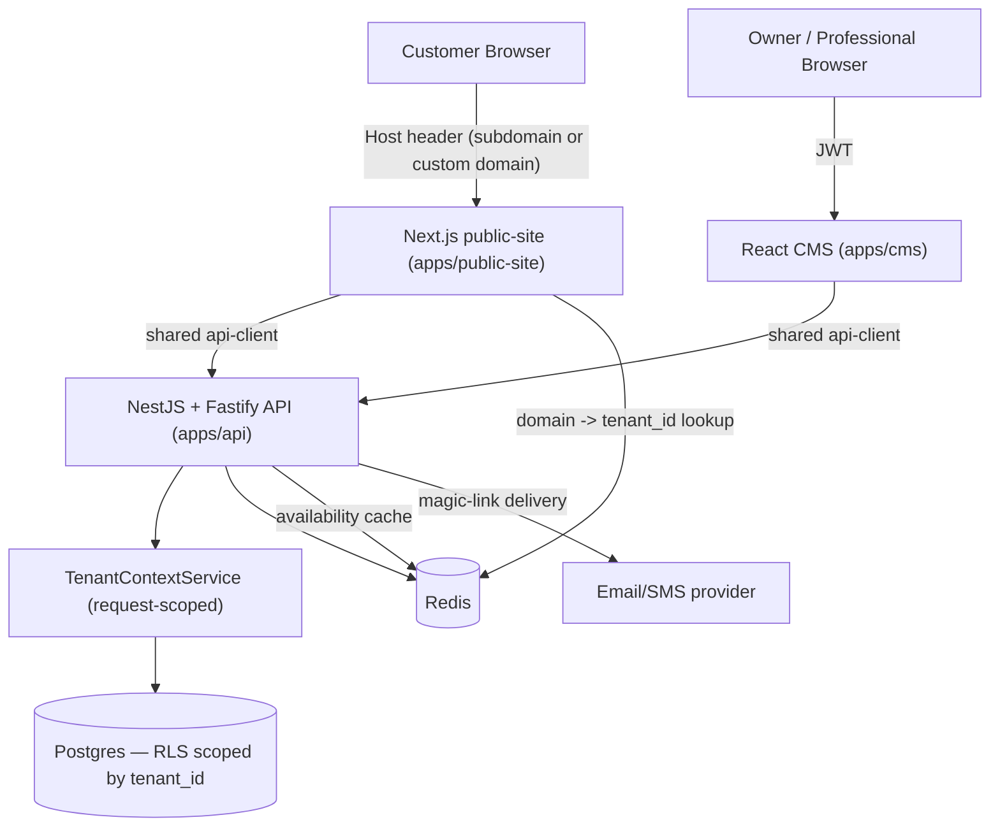

System architecture for the multi-tenant booking platform. This doc covers how the pieces fit together and run; entity-level schema, the ER diagram, and capacity math live in `Unified Requirements and Data Model.md` and are referenced rather than repeated here.

## 1. Overview

One backend, two customer-facing apps, one shared Postgres database — plus a static marketing site for the platform itself (`apps/marketing`, R560), which talks to none of them. Salons (tenants) manage their business through a CMS; their customers book through a public site branded per-tenant. Neither app is deployed per-tenant — tenant identity is resolved dynamically at request time, not baked into a build.

## 2. Component Diagram



## 3. Monorepo & Application Structure

Turborepo (or Nx), one repo, affected-only builds so the two frontend apps don't couple release cadence to each other:

```
apps/
  api/            NestJS + Fastify — all business logic, RLS-aware DB access
  cms/            React — owner/professional login, tenant management
  public-site/    Next.js (SSR/ISR) — customer-facing, tenant resolved per request
  marketing/      Astro, fully static — the platform's own site on the root domain (R560)
packages/
  api-client/     typed client shared by cms + public-site
  shared-types/   Tenant/Service/Professional/Appointment/DTO shapes
  config/         eslint/tsconfig/tailwind config
  ui/             optional — only truly generic, non-branded pieces, if any
```

`shared-types` and `api-client` are what actually justify the monorepo here — the two frontends don't share UI, but they share a contract with `apps/api`, and that contract needs to change atomically across all three when the schema moves.

## 4. Multi-Tenancy Model

Shared tables + `tenant_id` + Postgres Row-Level Security on every table, including junction tables (`ServiceProfessional`) — chosen over table-per-tenant or schema-per-tenant to avoid migration overhead, catalog bloat, and to keep cross-tenant admin/reporting queries possible. Tenant resolution differs by app:

- **CMS**: tenant identity comes from the JWT (`tenant_id`, `role`, `professional_id` claims), issued at login.
- **Public site**: tenant identity comes from the request's `Host` header, resolved to a `tenant_id` via Redis (subdomain or custom domain → tenant), falling back to Postgres on a cache miss.

Either way, the resolved `tenant_id` is handed to a request-scoped `TenantContextService` in the API, which is the single place that sets the Postgres session variable RLS policies key off (e.g. `SET LOCAL app.tenant_id = $1` per transaction) — application code never manually filters by `tenant_id`; the database enforces it.

## 5. Data Layer

Postgres is the only datastore (no Mongo). Full entity list, column types, and the ER diagram are in `Unified Requirements and Data Model.md`; the short version: `Tenant`, `Location`, `Professional`, `TenantUser`, `Service`, `ServiceProfessional` (join table), `BusinessHours`, `TimeOff`, `Appointment`, `Visit`, `SlotHold`. Availability is computed at query time (`BusinessHours` minus `TimeOff` minus existing `Appointment`s) rather than stored as pre-generated slot rows — avoids keeping a second table in sync with every booking/cancellation. A multi-professional booking (R200) is planned the same way, one segment at a time: each segment is an ordinary single-professional check, chained back to back with up to `tenant.max_visit_gap_minutes` between them. While a customer finishes booking, the time they picked is held for 10 minutes (`SlotHold`, R250) and counts as busy for everyone else. Because availability is computed rather than reserved, every booking write first takes a Postgres advisory lock on (tenant, local date) and only then re-checks and writes, so two requests for the same time can't both pass the check (R260).

`Tenant.config_json` (JSONB) holds presentation config (theme, logo, copy); everything queryable — pricing, hours, staff, bookings — is normalized columns, not JSON blobs.

**One bounded exception: translations.** Customer-facing text a tenant authors in more than one language keeps its default locale in the normal column and its other locales in a sibling `*_i18n jsonb` column (`service.name` + `service.name_i18n`, and so on — the convention is spelled out in `Unified Requirements and Data Model.md` → "Localized content"). The rule holds where it matters: the plain column is still what anything filters, sorts or joins on, and only presentation text is ever stored this way. The alternative — a `translation(entity, entity_id, field, locale, value)` table — buys generality this product has no use for and turns every service listing into a join.

Locale resolution deliberately does **not** happen in the API. `apps/api` returns both the plain value and the map; the two frontends apply the fallback using one shared function in `packages/shared-types`. This keeps a single copy of the rule (the API can only `import type` from that package, so anything it called would have to be hand-duplicated) and keeps cached public-site payloads locale-independent, so switching language needs no refetch.

## 6. Authentication & Authorization

Two separate identity systems, deliberately not unified, plus platform staff:

- **CMS (`TenantUser`)**: email + password, JWT-issued as an httpOnly session cookie (R320). Exactly one `owner` role per tenant (partial unique constraint); any number of `professional` roles, each optionally linked to a `Professional` business record via nullable `professional_id`. `owner` has full CMS access; `professional` is restricted to their own appointments and their own hours/time-off. Role enforcement happens in the API layer, not in Postgres — RLS scopes rows to a tenant, it has no concept of roles within a tenant. Deactivating a `Professional` record does not cascade to disable their login; the owner does that by hand.
- **Public site customers**: no accounts at all. Each customer booking is a `Visit` (one or more single-professional appointments, R200) carrying a hashed, expiring access token; visiting `/manage/{token}` authorizes actions against that one visit only (details below).

- **Platform admin** (R430): one staff account from the API's environment (`ADMIN_EMAIL`, bcrypt `ADMIN_PASSWORD_HASH`), not a `TenantUser` and not tied to any tenant. Its session is a JWT signed with a key derived from `JWT_SECRET` but distinct from the CMS's, in an httpOnly, SameSite=Strict cookie scoped to `/admin`, with its id held in Redis so signing out revokes it. It can only onboard and list tenants; it never reads tenant-scoped data.

### Magic Link Flow

1. Customer books (name and a code-verified phone — no signup, no email, R270).
2. Server generates a token, stores its hash + expiry (`end of the visit's last segment + 24h`) on the `Visit` row.
3. Server texts a link to `/manage/{token}` to that phone, and the confirmation screen shows it.
4. The link scopes access to that single visit — all its segments, moved or cancelled together (R230). It's not a login, and it grants no access to any other booking.
5. The token is stable for the visit's life: rescheduling (customer or staff) only moves its expiry to the new end + 24h, so no new link is texted. Only lost-link recovery (6) replaces it.
6. Lost-link recovery: customer enters their phone number; server looks up upcoming, non-cancelled appointments for that number and texts fresh tokens — rate-limited to prevent phone-number enumeration, and answering identically whether or not anything matched. Re-sending replaces each link, so **while no SMS provider is configured it does nothing**: issuing a new link nobody receives would only destroy the customer's working one.

**Delivery.** The `NOTIFY` box in §2 is `NotificationService`. SMS goes through uBill (a Georgian bulk-SMS gateway, ~0.01 GEL per text) when `UBILL_API_KEY` and `UBILL_BRAND_ID` are set; without them it is log-only, which is how development runs. Texts are plain Latin (GSM-7) so each bills as one SMS — a single Georgian letter switches a message to Unicode (70 characters instead of 160). Mail (R310 password resets, R430 set-password links) goes through Resend (`MailService`, plain HTTPS) when `RESEND_API_KEY` and `MAIL_FROM` are set — the sending domain must be verified in Resend; without them it is log-only, and in development the log shows the link. `POST /public/appointments` returns the manage URL in its response either way (the confirmation screen shows it). While SMS is unconfigured the OTP comes back as `devCode` so the flow stays testable end to end; once it is configured the code only ever travels by SMS, and a failed send is a 503 — never a fallback that shows the code. Codes are limited to one per number per minute (429 `otp_cooldown` with the seconds left; the last code keeps working), 5 per number and 100 per salon per hour. Token generation, hashing, expiry and rotation are real regardless of how the link is delivered.

## 7. Domain & Tenant Routing

- **Subdomains** (default, zero per-tenant setup): one wildcard DNS record + one wildcard TLS cert cover every tenant. New tenant = insert a row; nothing else to provision.
- **Custom domains** (opt-in): tenant CNAMEs their domain to the platform; ownership is verified via a DNS TXT challenge before `Tenant.domain_verified_at` is set; TLS is provisioned per-domain via a managed provider (Cloudflare for SaaS / Vercel Domains API) rather than a self-run ACME setup, to avoid rate-limit and abuse issues as domain count grows.
- At pilot scale, custom-domain verification and cert provisioning are done by hand (per §9); this doc doesn't assume automated self-serve domain tooling exists yet — see `Unified Requirements and Data Model.md` → Capacity Estimates for the point (~10K tenants) where that stops being optional.

## 8. Caching Strategy (Redis)

- **Domain → tenant_id resolution**: on the hot path for every public-site request; short TTL or explicit invalidation on tenant domain changes.
- **Computed availability**: the public visit-slot answer is cached for 60s per tenant and query, under a per-tenant version that every committed tenant-scoped write bumps (`PrismaService.forTenant` reports writes; nothing has to remember to invalidate). A stale entry can only ever show a slot that a booking then re-checks (R260) — never write anything. Cached slots are re-filtered by the clock on read.
- Redis is not used as a system of record anywhere — losing it degrades latency (falls back to Postgres) rather than losing data.

## 9. Onboarding (current, manual)

Pilot tenants are onboarded by staff, not self-serve:

1. Business terms agreed directly with the salon owner.
2. An internal script/CLI creates the `Tenant` row + initial `TenantUser` (`owner`) in one transaction, assigning a subdomain.
3. Subdomain is live immediately (wildcard DNS/cert already cover it).
4. Owner sets their password and fills in services/professionals/hours themselves in the CMS.
5. Custom domain (if wanted): CNAME + TXT verification done by hand; domain added via the TLS provider's dashboard.
6. Smoke test: subdomain resolves, one end-to-end test booking, confirm branding renders correctly.

Step 2 is done from the **admin page** (R430): `GET /admin` on the API, a single self-contained page (strict CSP, its own script nonce) that signs platform staff in and calls `/admin/api/*`. It creates the tenant and owner through the same `OnboardingService` as `POST /internal/onboarding/tenants`, which stays for scripts.

Self-serve signup, automated domain verification, and fuller tenant management (suspending, editing, billing) remain deferred until tenant count makes them the bottleneck.

## 10. Deployment Topology

- **Local**: `docker-compose.yml` — Postgres, Redis, and all three apps, one command.
- **Production**: managed Postgres (RDS/Cloud SQL/Neon-class) and managed Redis (ElastiCache/Upstash-class) rather than self-run containers, for backups/failover/HA. Apps run as containers on a PaaS or lightweight orchestrator (Fly.io, Railway, ECS) — `docker-compose` itself isn't a production orchestrator. ISR pages from `public-site` sit behind a CDN/edge cache.
- **Environments.** Two copies of the whole stack, sharing nothing (database, Redis, secrets, admin login, payment merchant):
  - **Staging** — branch `main`, on `bukme.website`. Flitt's test merchant, short billing months, test salons only. Its booking sites tell search engines not to index them (`BLOCK_SEARCH_ENGINES=true` on the public site).
  - **Production** — branch `production`, on `book-it.ge`. A release is a merge of `main` into `production`, tagged (`v1.0.0`); a hotfix branches from `production` and is merged back into `main`.
- **Marketing site** (`apps/marketing`): a static Astro build (`dist/`) served from the root domain (`www` and the apex) by its own Vercel project, while businesses' subdomains stay on `public-site`. It has no runtime configuration: `SITE_URL`, `BLOCK_SEARCH_ENGINES` (`true` on staging), `PUBLIC_CMS_URL` and `API_URL` are read at build time, so changing one means a redeploy. The offered plans are fetched from `API_URL` + `/plans` during the build (required on Vercel; without it, local and CI builds fall back to R470's starting plans), and the API calls `MARKETING_DEPLOY_HOOK_URL` (that environment's Vercel deploy hook) after an admin edits a plan, so the prices follow within a build. Its contact page (R580) is a plain HTML form posting to `API_URL` + `/contact`; the API stores the request (`contact_request`, listed on the admin page), emails it to `CONTACT_NOTIFY_EMAIL` if set, and redirects to `MARKETING_URL`'s thank-you or try-again page — so the API needs `MARKETING_URL` set to the marketing site's origin. `public-site` reads the same `MARKETING_URL` at request time for the footer credit link on every booking site (R590; `https://book-it.ge` when unset). `vercel.json` gives every page one URL (trailing slash) and caches the hashed `/_astro/*` files for a year. It runs on Astro 5 because the repo is on Node 20; Astro 6+ needs Node 22. Its screenshots are committed images, retaken from the locally running apps with `pnpm --filter @booking/marketing screens`, which also redraws the shared-link preview cards (`src/assets/og/`, `pnpm --filter @booking/marketing og` alone) from the running page.
- **Deploys** come from the hosts' own Git integrations, not from CI: each Render service and Vercel project follows its environment's branch. Migrations run in the Render service's pre-deploy command (`pnpm --filter @booking/api prisma:deploy`) against that environment's database, so a failed migration stops the deploy. Nothing outside an environment holds its database URL.
- This topology holds through the 500-tenant stage without changes; see §11 for what's added as scale increases.

## 11. Scaling Plan

Full numbers in `Unified Requirements and Data Model.md` → Capacity Estimates. Summary of what actually changes at each threshold:

- **~500 tenants**: current topology as-is. No pooler, no read replica, no partitioning.
- **~10,000 tenants**: horizontal scaling of the public-site/API tier; add PgBouncer (Postgres connection limits get exceeded by pooled connections from multiple app replicas); add a read replica to keep CMS/reporting reads off the primary; start planning monthly partitioning of `Appointment`; move custom-domain verification/issuance from manual to an automated provider API.
- **~100,000 tenants**: partition `Appointment` by month (and likely sub-partition by `tenant_id` hash) so RLS filtering and partition pruning cooperate; Redis needs to be HA (a single instance failing now affects every tenant, not one); sharding tenants across multiple Postgres clusters becomes a legitimate discussion rather than premature optimization; custom-domain tooling needs renewal monitoring and churn cleanup, not just initial issuance.

The shared-tables-plus-RLS decision doesn't change at any of these points — what's added is operational scaffolding around it.

## 12. Non-Functional Requirements Mapping

| requirement | how it's met |
|---|---|
| SEO | ISR pages (landing, services) on `public-site`, not client-rendered. Language is a cookie rather than a URL segment, so middleware *rewrites* (never redirects) to an internal per-locale route — the visitor keeps one clean URL and each locale keeps its own ISR entry. The trade-off is accepted knowingly: crawlers only ever see the tenant's default locale. |
| P95 < 300ms | Redis-cached domain resolution on the hot path; flagged as an aggressive target worth validating against cold-cache/custom-domain cases early |
| Mobile-first | `public-site` design constraint, not an infra concern |
| Every table tenant-scoped | Postgres RLS on every table, enforced via `TenantContextService`, no exceptions |

## 12a. Operations & Security

- **Health**: `GET /health` (process up) and `GET /health/ready` (Postgres and Redis reachable) — the platform's health check uses the latter.
- **Error tracking**: Sentry in all three apps, enabled by a DSN env var and silent without one. Server-side only 5xx and unexpected errors are reported, tagged with the tenant. Every event and breadcrumb passes through `scrubEvent` first, which strips the credentials that ride in URLs (manage, reset and invite tokens, hold ids).
- **Rate limits (R330)**: fixed windows in Redis (one atomic INCR + EXPIRE NX), keyed by salon and client address and, where it matters, by account or phone. The client address is Fastify's `request.ip` with `trustProxy` set to exactly the platform's proxy hop count (`TRUST_PROXY`, never blanket trust — a client could otherwise pick its own address; on Render it is 2, Cloudflare then Render's proxy); for public calls, which the public site's server makes on a visitor's behalf, the visitor is named in `X-Visitor-IP` and believed only alongside a shared key (`PUBLIC_SITE_API_KEY` on the API, `BOOKING_SITE_API_KEY` on the public site — same value). Like the other Redis uses, a Redis outage fails open rather than taking booking offline — and fails fast: Redis commands time out after 1s with no offline queue, so 'open' never means 'hung'.
- **Sessions (R320)**: the JWT travels only in an httpOnly, SameSite=Strict, Secure (in production) cookie scoped to `/cms`, so an injected script has no token to steal; the CMS learns who is signed in from `GET /cms/auth/me`. JWTs carry a session id and the user's session version; the guard rejects a revoked session id (Redis, until the token's own expiry) or a stale version (Postgres) on every request. CSRF: SameSite=Strict, plus every non-GET `/cms` request must send `X-Requested-With: booking-cms`, which a cross-site form can't and a cross-origin script can't without a CORS preflight that only the CMS origin passes. **Deployment constraint:** the CMS and the API must share a registrable domain (e.g. `cms.example.com` and `api.example.com`), or the browser won't send a Strict cookie.
- **Headers**: the API sends security headers (Helmet); the public site sets them in `next.config`; the CMS ships a Content-Security-Policy in its HTML. Swagger (`/docs`) is off in production.

## 12b. Subscription billing (Flitt)

Salons pay the platform monthly (R470–R490). Customers still never pay online.

- **Provider:** [Flitt](https://docs.flitt.com/api/introduction/) (TBC's gateway). One platform merchant (`FLITT_MERCHANT_ID` / `FLITT_SECRET_KEY`); without them the billing endpoints answer 503, nothing is charged, and nobody is paused (R490) — so deploying before the merchant exists is safe. Development and the test environment use Flitt's public test merchant and test cards; going live needs a merchant account (a TBC business account).
- **No card data touches the platform.** The first payment, and a card change, happen on Flitt's hosted page (`/api/checkout/url`, `required_rectoken=Y`). Flitt returns a card token (`rectoken`) and a masked number; renewals charge the token host-to-host (`/api/recurring`).
- **We run the schedule, not Flitt.** Flitt's own subscriptions fix the amount at signup, which rules out plan switches at renewal; charging the token ourselves keeps plan changes, retries and the trial in one place. `BillingScheduler` runs inside the API every few minutes: for each tenant (the `tenant` table has no RLS) it opens that tenant's context and charges a subscription that is due. No global lock is needed: a due subscription is leased (`retry_at` pushed forward with a conditional update), and the order id is derived from the period and attempt, so a second instance — or Flitt itself, which rejects a reused order id — can't charge the same month twice.
- **Trusting results:** every Flitt response and callback is checked against its SHA-1 signature (secret first, then the non-empty fields sorted by name, `|`-joined) and against the payment we recorded (merchant, amount, currency). Payment results are applied by one idempotent function, whichever arrives first: the server callback (`POST /billing/flitt/callback`), the synchronous answer of a renewal, or the CMS asking after the customer returns from Flitt's page (`/api/status/order_id`) — so local development works without a callback reaching it.
- **Return path:** Flitt sends the payer back to `GET|POST /billing/flitt/return?order=…`, which redirects to the CMS subscription page; the CMS then asks the API to confirm that order.
- **Status is derived** (`billing/subscription-status.ts`) from the trial end, the paid-through date, the cancel flag and the admin's free flag, with a 7-day grace. A lapsed salon's public tenant carries `bookingPaused`, the booking site shows a notice instead of the wizard, and `VisitService` refuses holds and bookings (R490).
- **Plans live in the `subscription_plan` table (R470/R540/R550)**, edited on the admin page: price, `max_locations`, `offered`. Texts are unlimited on every plan (R500), so a plan has no allowance. Subscriptions and payments reference a plan by id (foreign key, restrict on delete). The table is platform-wide — no `tenant_id`, no RLS — and is read inside the tenant's transaction wherever billing needs it (a handful of rows, read per request rather than cached, so an edit is seen by every API instance at once). The pure rules in `billing/plans.ts` (`locationLimit`, `planFits`) take the plan rows as an argument. Plans are named in the table too (`name` in English, `name_i18n` for Georgian and Russian; frontends show them through `planName()` from `@booking/shared-types`), so the page can also add a plan (id made from its English name) and delete one: the restrict foreign keys refuse a plan any subscription or payment points at, and the API also keeps the default plan new salons start on and the last offered plan. The admin page shows one section at a time (`#salons`, `#new-salon`, `#contacts`, `#plans`) and pages the salon and contact-request lists 20 rows at a time. The location limit is checked where locations are created or reopened, and where a plan is paid for or switched to (`BillingService.assertLocationAllowedIn`).
- **SMS usage (R500):** `NotificationService` records every text uBill accepts as one `sms_message` row (tenant, kind, parts, time) in the sending tenant's context. Recording is best effort and never fails a send. The count is the platform's own cost record: the admin page shows each salon's texts for the calendar month on its clock. Nothing is charged per text and no owner sees a count, so a renewal charges exactly the plan's price.
- **Testing renewals:** `BILLING_CYCLE` (default `month`; e.g. `10m` or `1d`), `BILLING_GRACE` (default `7d`) and `BILLING_RETRY` (default `1d`) let a test environment run months in minutes. Production leaves them unset.

## 13. Open Items

- Customer payment is out of scope for now (reservation-only booking, customer pays in person). Salons paying the platform is §12b. Deposits would need their own design: the money belongs to each salon, so each would need its own merchant.
- Whether "service without a professional" (resource/walk-in-style bookings) needs to be explicitly supported — if so, needs a `Service.requires_professional` flag and a capacity model, since nothing currently prevents double-booking a professional-less service.
- Passwordless/OTP login for CMS was considered and explicitly declined in favor of email+password — noted here so it isn't re-litigated without a reason to revisit.
